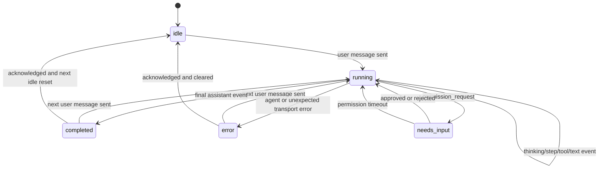

# Persistent Agent Runs Across Tabs — Design

**Date:** 2026-07-20  
**Status:** Approved design  
**Target:** Tauri desktop frontend (`desktop/`) with one minimal WebSocket protocol addition in `web/backend/main.py`

## Problem

Switching application tabs currently destroys an active agent run instead of merely hiding its UI:

1. `App.jsx` renders only `panels[activeTab]`, so the previous panel unmounts.
2. `ChatPanel` and `CodingPanel` close their WebSocket in effect cleanup.
3. The backend `_safe_send` sees the disconnected client and sets `cancel_event`.
4. `agent.run()` stops at its next cancellation boundary and the WebSocket handler exits.

The existing session guard warns that switching may interrupt the run, but choosing **Switch Anyway** performs the destructive unmount. Agent status is also incomplete: `AgentActivityContext` represents only one logical agent, Chat does not feed it, and the title/status bars cannot distinguish simultaneous Chat and Coding activity.

## Goals

- Keep the current Chat run alive while navigating to Coding, Tasks, Settings, Help, or media panels.
- Keep the current Coding run alive while navigating elsewhere.
- Allow one Chat run and one Coding run concurrently.
- Show each running or attention-required session on its owning sidebar tab.
- Provide a global, clickable list of running work in the StatusBar.
- Preserve the existing tool-permission safety model; background work must never auto-approve a protected tool.
- Keep the active panel's token/context meter correct while both agent panels remain mounted.
- Preserve messages, streaming deltas, tool progress, and completion state when returning to a tab.

## Non-goals

- Surviving a frontend refresh, backend restart, or application restart.
- Running multiple conversations concurrently within Chat or within Coding.
- A persistent server-side event log or reconnect cursor.
- Native OS notifications while the application is hidden or closed.
- Replacing the WebSocket transport or conversation storage format.
- A general-purpose background job system for media generation.

## Considered Approaches

### 1. Keep agent panels mounted and hide inactive panels — selected

Mount Chat and Coding on first visit, retain them for the lifetime of `AppShell`, and hide the inactive panel. Their WebSockets and React state survive navigation. Add a session-keyed activity registry above both panels.

Benefits:

- Removes the observed unmount → disconnect → cancellation chain at its source.
- Requires no durable-run subsystem.
- Preserves the current streaming and permission-request WebSocket flow.
- Supports one Chat and one Coding run concurrently.

Costs:

- Chat and Coding consume memory while hidden.
- Components that measure their container, especially XTerm/editor views, need a resize signal when shown again.
- A small backend event is still needed to make permission-request timeout explicit rather than silent.

### 2. Move WebSockets and all message state into a global runtime provider

This cleanly separates screen lifetime from run lifetime and could support many simultaneous conversations. It would require decomposing the large Chat and Coding components and replacing their current state ownership. This is disproportionate for the requested two-panel concurrency and remains a possible later migration.

### 3. Durable backend runs with replayable event buffers

Run agents as server-owned `asyncio.Task` objects, buffer streaming events, expose status/cancel endpoints, and reconnect by cursor. This is required for refresh/restart resilience, but it introduces persistence, replay ordering, checkpointing, TTL, and cancellation policy that are outside this feature's scope.

## Selected Architecture

### Panel lifetime

`AppShell` owns a visited-panel set. Chat and Coding mount when first selected and stay mounted until `AppShell` itself unmounts. Inactive agent panels are visually hidden and excluded from focus/accessibility navigation.

Conceptually:

```jsx
<section hidden={activeTab !== 'chat'} aria-hidden={activeTab !== 'chat'}>
  <ChatPanel active={activeTab === 'chat'} />
</section>
<section hidden={activeTab !== 'code'} aria-hidden={activeTab !== 'code'}>
  <CodingPanel active={activeTab === 'code'} />
</section>
```

The implementation may use a shared `KeepAlivePanel` wrapper. It must not clone two instances of the same agent panel, and it must not change a panel's `key` on ordinary navigation.

Non-agent panels may retain the current conditional-rendering behavior. They do not own Chat/Coding WebSockets.

When Coding becomes visible, it receives an activation signal that causes editor and XTerm container measurements to refresh. Hidden content must not retain focus.

### Navigation protection

Ordinary tab navigation is non-destructive and must not open the current **Session Active / Switch Anyway** dialog.

Protection remains for actions that destroy or detach an active run:

- New Chat in the same panel.
- Loading another conversation into the same panel.
- Deleting the active conversation.
- Clearing/remounting the active Chat panel through the command palette.
- Changing a locked Coding workspace.
- Refreshing, closing the window, or quitting the application.

The confirmation must name the number and origin of affected runs where the platform permits custom text. Browser `beforeunload` may show only the platform's generic warning.

### Concurrency

The supported execution slots are:

- The current Chat session: zero or one active run.
- The current Coding session: zero or one active run.

Therefore, the application supports at most two concurrent agent runs in this release. A panel does not queue an additional user message while its session is `running` or `needs_input`; its composer remains unavailable until the current turn resolves. Switching panels never changes either run's status.

## Session Activity Registry

`AgentActivityContext` becomes a registry keyed by `sessionId` rather than a singleton activity record.

```ts
type RunStatus =
  | 'idle'
  | 'running'
  | 'needs_input'
  | 'completed'
  | 'error'

type RunPhase = 'thinking' | 'tool' | 'responding' | null

type SessionActivity = {
  sessionId: string
  tabId: 'chat' | 'code'
  kind: 'chat' | 'coding'
  title: string
  status: RunStatus
  phase: RunPhase
  startedAt: number | null
  updatedAt: number
  currentStep: { current: number; max: number | null } | null
  lastTool: string | null
  permissionRequest: PermissionSummary | null
  unread: boolean
  error: string | null
  activity: {
    thinking: ThinkingState
    steps: Step[]
    toolResults: ToolResult[]
    plan: PlanState
  }
}
```

Registry operations always require a session ID:

- `registerSession(sessionId, metadata)`
- `unregisterSession(sessionId)`
- `startRun(sessionId)`
- `recordEvent(sessionId, event)`
- `requestAttention(sessionId, permission)`
- `resolveAttention(sessionId, resolution)`
- `completeRun(sessionId)`
- `failRun(sessionId, error)`
- `acknowledgeSession(sessionId)`
- `clearSessionActivity(sessionId)`

Selectors provide stable, derived views:

- `getSessionActivity(sessionId)`
- `getTabSummary(tabId)`
- `getRunningSessions()`
- `getAttentionSessions()`
- `getGlobalAgentSummary()`

### Registry invariants

1. Chat events can update only the Chat session that received them.
2. Coding events can update only the Coding session that received them.
3. Navigation never clears or completes activity.
4. Sending a user message transitions `idle`, `completed`, or acknowledged `error` to `running`.
5. `permission_request` transitions `running` to `needs_input`.
6. Approval or rejection transitions `needs_input` back to `running`; timeout records an explicit rejection reason.
7. Only a final `assistant` event transitions a successful run to `completed`.
8. An agent or transport error transitions an active session to `error`.
9. Completion or error is unread if its owning tab was not active when the event arrived.
10. Opening the owning tab acknowledges unread completion/error, without deleting conversation content or detailed activity.

## State Machine



Tab navigation is intentionally absent from the state machine.

## Status Surfaces

### Sidebar badges

Chat and Coding entries show their own aggregate status:

| State | Badge |
|---|---|
| Any session `needs_input` | Amber exclamation, highest priority |
| Any session `error` and unread | Red dot |
| Any session `running` | Animated primary dot |
| Any session `completed` and unread | Green dot |
| Idle/acknowledged | No badge |

Because this release has one session slot per agent tab, each badge maps directly to that tab's current session. Badge labels include accessible text; color is not the sole signal.

### StatusBar global summary

Replace the current singleton `AgentStatus` derivation with a registry selector:

- No active or attention sessions: **Agent idle**
- One active session: **1 agent running**
- Two active sessions: **2 agents running**
- Any permission request: **1 needs attention** (takes visual priority)
- Any unread error: **1 agent error**

Global summary priority is `needs_input` → unread `error` → `running` → unread `completed` → `idle`. Counts in the popover still show every session even when a higher-priority summary label wins.

Clicking the summary opens a popover. Each row includes:

- Chat or Coding origin.
- Conversation title or Coding workspace title.
- Current phase or last tool.
- Elapsed time.
- Status indicator.
- An action that navigates to the owning tab without interrupting it.

Direct cancellation from the popover is excluded from the first release. Destructive actions remain inside the owning panel.

### Titlebar

The Titlebar keeps a compact global dot, but its state comes from the same global selector as the StatusBar. It must not independently reimplement run/error priority. The StatusBar is the detailed and interactive surface.

## Background Permission Requests

Protected tools must never auto-approve merely because their panel is hidden.

On `permission_request`:

1. The session enters `needs_input`.
2. Its sidebar tab receives the amber attention badge.
3. StatusBar changes immediately to **Needs attention**.
4. A persistent, global attention notice appears above all panels with the tool name, owning tab, a visible 120-second countdown, and **Review** action.
5. **Review** navigates to the owning panel, where the existing approval/rejection UI remains authoritative.
6. Approval or rejection clears the global notice and resumes the agent.

The backend currently rejects a permission request after 120 seconds. Under background execution, a timeout must not be silent. The WebSocket protocol gains a minimal `permission_expired` event containing `request_id`, `tool_name`, and a timeout reason before the callback returns `rejected`. The frontend clears `needs_input`, records the rejection in that session's activity, and shows an unread notice in the owning tab. The 120-second safety timeout remains unchanged; the persistent global notice makes the deadline visible throughout the application without weakening tool safety.

If the WebSocket disconnects during permission handling, the existing cancellation/error behavior remains appropriate because the requested app-lifetime guarantee cannot be upheld without the connection.

## Token and Visible Session Ownership

Keeping both panels mounted invalidates the current mount-based `SessionTokensContext.setActiveSessionId()` policy: both panels would compete to become active.

The replacement separates registration from visibility:

- Each panel registers its session ID and continues recording usage into the existing per-session token bucket.
- `AppShell.activeTab` determines `visibleSessionId`.
- The StatusBar context/token meter reads only `visibleSessionId`.
- The agent summary reads all activity-registry sessions.
- Existing token bucket persistence in `localStorage` remains unchanged.

Chat keeps its existing `chat-session-id` persistence. Coding only needs app-lifetime persistence for this feature; adding restart persistence for `codingSessionId` is not required.

## Completion, Error, and Reconnection Behavior

### Completion in a hidden tab

- Store the final assistant message through the current WebSocket flow.
- Set `status: 'completed'` and `unread: true`.
- Show a green owning-tab badge and a completed row in the StatusBar popover.
- Acknowledge the notification when the user opens that tab.

### Error in a hidden tab

- Set `status: 'error'`, preserve the error message, and mark it unread.
- Show red status in Sidebar and StatusBar.
- Keep the existing in-panel error/system message for details.

### Unexpected WebSocket close

- If the session was `running` or `needs_input`, mark it as an explicit transport error: the run was interrupted because the connection closed.
- If the session was idle, only update connection health; do not create a run error.
- Ordinary tab navigation must never produce this close.

### Refresh or application restart

This release does not keep an in-flight agent alive through refresh or restart. Conversation JSON still restores completed messages as it does today. A future durable-run design must introduce server-owned tasks, event replay, checkpointing, and explicit cancellation endpoints rather than extending this frontend keep-alive mechanism.

## Component Changes

### `desktop/src/App.jsx`

- Own visited-agent-panel state.
- Keep Chat and Coding mounted after first visit.
- Pass visibility/activation state to agent panels.
- Derive visible session ownership from `activeTab`.
- Stop treating ordinary tab navigation as a destructive risk.
- Retain guards for destructive actions and window close.

### `desktop/src/context/AgentActivityContext.jsx`

- Replace singleton fields with the session-keyed registry.
- Expose session-scoped actions and shared selectors.
- Keep immutable updates localized to the changed session.

### `desktop/src/components/chat/ChatPanel.jsx`

- Register Chat session metadata.
- Translate user/status/thinking/tool/permission/assistant/error events into session-scoped activity actions.
- Keep WebSocket cleanup for true panel/application unmount.
- Protect conversation switches and new-chat actions during an active run.

### `desktop/src/components/coding/CodingPanel.jsx`

- Replace unscoped activity mutations with coding-session-scoped operations.
- Keep the existing workspace/plan/tool UI bound to the current Coding session.
- Refresh editor/terminal layout after the panel becomes visible.
- Protect destructive session actions while running.

### `desktop/src/context/SessionTokensContext.jsx`

- Separate session registration from `visibleSessionId`.
- Continue persisting usage buckets by session ID.

### `desktop/src/components/Sidebar.jsx`

- Render accessible Chat/Coding status badges from tab summaries.

### `desktop/src/components/shared/StatusBar.jsx`

- Render the global summary and session-list popover.
- Navigate to an owning tab without mutating run state.

### `desktop/src/components/shell/Titlebar.jsx`

- Consume the shared global selector instead of computing singleton status.

### `web/backend/main.py`

- Emit `permission_expired` before returning `rejected` on the existing 120-second permission timeout.
- Do not introduce a background task, replay buffer, or status endpoint.

### Localization

Add all new labels, counts, phases, attention messages, timeout text, and accessible badge labels to all six locale files. No new user-visible English literals are introduced in the touched UI.

## Error Handling

- Malformed or unknown WebSocket events do not clear another session's registry state.
- Registry actions for an unknown session first register a minimal session record or reject the action consistently; they never update a global singleton fallback.
- Failure to render or open the StatusBar popover does not affect the WebSocket or run.
- Editor/XTerm resize failure is logged and leaves the Coding run intact.
- Permission timeout is explicit through `permission_expired`; it is not treated as an agent transport error.
- A destructive-action confirmation that is dismissed leaves the current run and panel state untouched.

## Verification

### Behavioral smoke scenarios

1. Start a multi-step Chat request, switch to Coding, observe Chat continue streaming, then return and see all intermediate/final output.
2. Start a Coding request, switch to Chat or Settings, observe tool/file events continue, then return with editor and terminal correctly sized.
3. Run Chat and Coding simultaneously and observe two independent animated sidebar badges and two StatusBar rows.
4. Confirm Chat thinking/tool events never overwrite Coding steps, tool results, or plans, and vice versa.
5. Trigger a protected tool from a hidden panel; observe the global attention notice, navigate via **Review**, approve, and observe the same run resume.
6. Let a permission request expire; observe `permission_expired`, removal of the attention state, and an explicit unread rejection notice.
7. Navigate through Tasks, Settings, Help, and media panels during both runs; neither agent WebSocket closes.
8. Switch between Chat and Coding and confirm the context/token meter follows the visible session.
9. Attempt New Chat, conversation switch/delete, and Coding workspace change during a run; each destructive path is prevented or explicitly confirmed.
10. Complete a hidden run; observe unread completion, navigate to it, acknowledge it, and confirm the saved assistant response remains in conversation history.
11. Force an unexpected active-run WebSocket close and confirm the registry reports an interruption error rather than idle.
12. Close/refresh the app with one or two runs active and confirm the existing platform-appropriate close protection appears.

### Automated coverage

- Reducer/context tests for session isolation, transitions, unread acknowledgement, and summary priority.
- App rendering test proving Chat/Coding instances are not unmounted on tab navigation.
- Sidebar badge tests for running, attention, completed, and error priority.
- StatusBar popover tests for zero, one, and two runs plus navigation actions.
- SessionTokensContext tests proving visible session changes independently of mounted registrations.
- Backend WebSocket test proving permission timeout emits `permission_expired` before rejection.

## Acceptance Criteria

The feature is complete when tab navigation cannot cause the active Chat or Coding WebSocket to close, one Chat and one Coding turn can finish concurrently, all global and per-tab status surfaces remain session-correct, background permission requests are globally visible and explicitly time out, and every destructive action still protects the affected active run.
